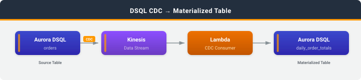

# DSQL CDC Materialized Table

## Introduction

This sample maintains a pre-computed aggregate table in Amazon Aurora DSQL using change data capture (CDC). An AWS Lambda function consumes change events for the `orders` table and incrementally updates a `daily_order_totals` summary table. Dashboard queries read the summary with a primary key lookup instead of running `GROUP BY` over every order.

Aurora DSQL does not support materialized views. This pattern gives you the same result, aggregates that stay current as the source data changes, by driving incremental updates from CDC.

```sql
-- Instead of scanning and aggregating orders on every query:
SELECT order_date, COUNT(*), SUM(total_amount) FROM orders GROUP BY order_date;

-- Read the materialized table directly:
SELECT * FROM daily_order_totals WHERE order_date = '2026-10-15';
```

### What you'll learn

- How to set up CDC streaming from Amazon Aurora DSQL to Amazon Kinesis
- How to consume CDC events in AWS Lambda and write back to DSQL
- How to keep an aggregate correct when CDC delivery is at-least-once and unordered, and update/delete events carry no previous row image
- How to retry DSQL optimistic concurrency conflicts

## Architecture



```
DSQL (orders) --> Kinesis --> Lambda consumer --> DSQL (daily_order_totals)
                                   |
                                   +--> SQS DLQ (records that cannot be applied)
```

1. The `orders` table in DSQL is the operational source of truth.
2. CDC streams every INSERT, UPDATE, and DELETE on `orders` to a Kinesis data stream.
3. A Lambda function consumes batches of CDC events and applies them to `daily_order_totals` in one DSQL transaction per batch.
4. Dashboard queries (and the demo) read `daily_order_totals` directly.

## What Gets Deployed

| Resource | Service | Purpose |
|----------|---------|---------|
| Kinesis data stream | Amazon Kinesis | Receives CDC events from DSQL |
| Consumer function | AWS Lambda | Applies CDC events to `daily_order_totals` |
| psycopg2 layer | AWS Lambda | PostgreSQL driver for the consumer |
| Event source mapping | AWS Lambda | Delivers Kinesis batches to the consumer |
| Dead-letter queue | Amazon SQS | Records batches that failed after retries |
| Log group | Amazon CloudWatch Logs | Consumer logs (30-day retention) |
| IAM roles | AWS IAM | Least-privilege roles for DSQL and Lambda |
| Artifact bucket (created by `deploy.sh`) | Amazon S3 | Lambda layer and code zips |

Stack name: `DsqlCdcMaterializedTableStack`

## Project Structure

```
deploy.sh               # CloudShell: build artifacts, deploy infrastructure, launch the demo
destroy.sh              # CloudShell: remove all deployed resources
demo.py                 # Interactive CLI: generate/mutate orders, view and verify totals
cfn/                    # CloudFormation template
lambda/                 # Lambda consumer source (zipped and deployed by deploy.sh)
sql/                    # DSQL table DDL
docs/                   # Architecture diagram
```

## Prerequisites

**CloudShell (deploy and demo):**
- Python 3.9+
- pip
- AWS CLI v2.34.61+ (includes the Aurora DSQL CDC stream commands)
- jq 1.6+
- zip

**Required IAM permissions:** The deploying principal needs permissions for AWS CloudFormation, Amazon Aurora DSQL, Amazon Kinesis, AWS Lambda, Amazon SQS, Amazon S3, AWS IAM, and Amazon CloudWatch Logs.

**Estimated cost:** Running this sample for a few hours with approximately 500 CDC events costs less than $1.00 USD. To avoid ongoing charges, follow the [Cleanup](#cleanup) instructions when you are done.

## Quick Start

### Step 1: Deploy (CloudShell)

```bash
git clone https://github.com/aws-samples/sample-dsql-cdc-patterns.git
cd sample-dsql-cdc-patterns/patterns/dsql-materialized-table
bash deploy.sh
```

The script creates a DSQL cluster and an S3 bucket for the Lambda artifacts. It builds the psycopg2 layer for the Lambda runtime (Python 3.12, x86_64), deploys the CloudFormation stack, creates the tables, and sets up the CDC stream. Deployment takes about 5 minutes. It writes the resulting configuration to `env.sh` and then starts the interactive demo.

Options:
```bash
bash deploy.sh --cluster-id abc123    # reuse existing cluster
bash deploy.sh --region us-west-2     # non-default region
bash deploy.sh --no-demo              # deploy only
```

Re-running `deploy.sh --cluster-id <id>` after editing `lambda/index.py` uploads the new code under a content-addressed key, so CloudFormation updates the function.

### Step 2: Run the demo

The demo starts automatically at the end of `deploy.sh`. To start it again later:

```bash
source env.sh
python3 demo.py
```

The demo menu lets you:
- **Generate orders** -- insert random orders spread over a number of days
- **Mutate orders** -- change an order's amount, move it to another day, or delete it
- **View materialized totals** -- read `daily_order_totals`
- **Verify** -- compare `daily_order_totals` with a live `GROUP BY` over `orders`
- **Clear all data** -- delete every order; the totals drain to empty as the consumer processes the deletes
- **Health check** -- DSQL connectivity, row counts, and the number of messages in the DLQ

The consumer processes changes within about 15 seconds. Run **Verify** after that; it should report `PASS`.

## CDC Record Format

Amazon Aurora DSQL streams each change as a JSON envelope. See [Understanding CDC records](https://docs.aws.amazon.com/aurora-dsql/latest/userguide/cdc-record-format.html) and [Ordering and delivery semantics](https://docs.aws.amazon.com/aurora-dsql/latest/userguide/cdc-streams.html).

- INSERT (`op: "c"`) and UPDATE (`op: "u"`) carry the **full** post-change row in `after`. `before` is `null`, **including for updates**.
- DELETE (`op: "d"`) sets `after` to `null` and puts **only the primary key** in `before`.
- Transaction metadata (`txId`, `ts_ms`, `ts_ns`) lives under `source`. `source.ts_ns` is the commit time and gives a total order of transactions. The top-level `ts_ms`/`ts_ns` are CDC *processing* times.
- `date` columns are integers (days since the Unix epoch). `numeric` columns are strings (for example `"29.99"`).
- Delivery is at-least-once and **unordered**. The same record can arrive more than once, and changes to the same row can arrive out of commit order.
- Oversized rows arrive as `type: "chunked"` records plus `type: "fragment"` continuations. The consumer does not reassemble them; it reports them as failed so they end up in the DLQ. `orders` rows are far below the 9 MiB threshold.

## How the Consumer Keeps the Totals Correct

Because update and delete events don't include the order's previous date or amount, the consumer can't compute a delta from the event alone. Because delivery is at-least-once and unordered, it also can't add every event it sees. It keeps one bookkeeping row per order in `order_contributions`:

| Column | Meaning |
|--------|---------|
| `order_id` | Primary key of the source order |
| `order_date`, `total_amount` | What the order currently contributes to `daily_order_totals` |
| `is_deleted` | Tombstone: the order was deleted |
| `source_ts_ns` | Commit timestamp of the CDC event that set this row |

For each Kinesis batch, in one DSQL transaction, the consumer:

1. Keeps only the newest event per `order_id` in the batch.
2. Reads the stored contributions for those orders.
3. Skips any event whose `source.ts_ns` is not newer than the stored one. Duplicates and stale out-of-order events are dropped here.
4. Subtracts the stored contribution (if any), adds the new one (none for a delete), and applies the per-date count and revenue deltas to `daily_order_totals`. A date with no remaining orders is removed.
5. Upserts the new contributions. Deletes are kept as tombstones, so an older update that arrives after the delete can't bring the order back.

`daily_order_totals` therefore always equals the aggregate over the newest version of each order seen so far, in whatever order the events arrive. Processing the same batch again changes nothing, so Kinesis retries are safe.

If the transaction hits a DSQL optimistic concurrency conflict (SQLSTATE `40001`), the consumer retries it with backoff up to 5 times. If the batch still fails, the consumer fails it and Kinesis retries it. Records the consumer can't parse are reported individually (`ReportBatchItemFailures`), and the rest of the batch is still applied. After 3 retries, the failed batch's metadata goes to the SQS DLQ.

**Considerations for production:**
- Tombstones accumulate in `order_contributions`. You can safely delete tombstones older than the maximum redelivery window, which is the Kinesis retention period (24 hours by default).
- The CDC stream covers every table in the cluster, so the consumer's own writes to `daily_order_totals` and `order_contributions` also appear on the stream. The consumer ignores them by table name.
- All orders for the same day update the same `daily_order_totals` row. Under heavy concurrent load (more shards or a higher parallelization factor), expect more OCC retries on that row.

## Security

- Amazon Kinesis: KMS encryption at rest
- Amazon SQS: SSE-SQS encryption at rest
- Amazon S3 artifact bucket: `BlockPublicAccess` enabled, SSL-only bucket policy
- AWS IAM: least-privilege roles; the consumer can connect only to this DSQL cluster, read only this stream, and write only to this DLQ
- Amazon Aurora DSQL: SSL connections with IAM auth tokens (15-minute expiry); all SQL is parameterized
- No public endpoints or AWS Lambda function URLs

## Cleanup

> **Important:** The resources deployed by this sample incur ongoing AWS charges. To avoid unexpected costs, clean up all resources when you are done.

```bash
bash destroy.sh
```

`destroy.sh` reads `CLUSTER_ID`, `STREAM_ID`, and `ARTIFACT_BUCKET_NAME` from `env.sh`. It deletes:
1. **CDC stream** -- deleted through the DSQL API
2. **CloudFormation stack** -- the Kinesis data stream, Lambda function and layer, event source mapping, SQS DLQ, IAM roles, and CloudWatch Logs log group
3. **Artifact bucket** -- the S3 bucket that `deploy.sh` created for the Lambda layer and code zips
4. **DSQL cluster** -- deletion protection is disabled and the cluster is deleted

> **Warning:** Deleting the DSQL cluster permanently destroys the `orders`, `daily_order_totals`, and `order_contributions` tables. This action cannot be undone.
