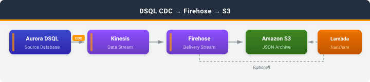

# DSQL CDC to S3 via Amazon Data Firehose

## Introduction

This sample delivers change data capture (CDC) events from Amazon Aurora DSQL to Amazon S3 through Amazon Data Firehose. Use it for archival, compliance auditing, and batch analytics with Amazon Athena.

Every INSERT, UPDATE, and DELETE in your DSQL table is written to S3 as GZIP-compressed, date-partitioned, newline-delimited JSON. An optional AWS Lambda transform flattens each CDC record so Athena can query it directly.

### What you'll learn

- How to set up CDC streaming from Amazon Aurora DSQL to Amazon Kinesis
- How to deliver CDC events to S3 with Amazon Data Firehose, with an optional Lambda transform
- How to read the DSQL CDC record format (commit timestamps, row images, delete keys)
- How to query the archived events in place with Amazon Athena

## Architecture



```
DSQL --> Kinesis --> Firehose --(optional Lambda transform)--> S3 --> Athena
```

1. Aurora DSQL streams CDC events to a Kinesis data stream.
2. A Firehose delivery stream reads from the Kinesis data stream.
3. An optional Lambda transform flattens each CDC record into a single-level JSON object.
4. Firehose buffers records and writes GZIP-compressed, date-partitioned files to S3.
5. Athena queries the files in place using a partition-projected external table.

## What Gets Deployed

| Resource | Service | Purpose |
|----------|---------|---------|
| Kinesis data stream | Amazon Kinesis | Receives CDC events from DSQL |
| Delivery stream | Amazon Data Firehose | Buffers and writes CDC events to S3 |
| Transform function (optional) | AWS Lambda | Flattens CDC records for Athena |
| S3 bucket | Amazon S3 | Encrypted, versioned CDC archive |
| Log group | Amazon CloudWatch Logs | Firehose delivery errors |
| IAM roles | AWS IAM | Least-privilege roles for DSQL, Firehose, and Lambda |

Stack name: `DsqlCdcFirehoseStack`

## Project Structure

```
deploy.sh               # CloudShell: deploy infrastructure and launch the demo
destroy.sh              # CloudShell: remove all deployed resources
demo.py                 # Interactive CLI: generate changes and browse CDC events in S3
cfn/                    # CloudFormation template
lambda/                 # Lambda transform source (readable copy)
sql/                    # DSQL table DDL + Athena external table DDL
docs/                   # Architecture diagram
```

## Prerequisites

**CloudShell (deploy and demo):**
- Python 3.9+
- pip
- AWS CLI v2.34.61+ (includes the Aurora DSQL CDC stream commands)
- jq 1.6+

**Required IAM permissions:** The deploying principal needs permissions for AWS CloudFormation, Amazon Aurora DSQL, Amazon Kinesis, Amazon Data Firehose, AWS Lambda, Amazon S3, AWS IAM, and Amazon CloudWatch Logs.

**Estimated cost:** Running this sample for a few hours with approximately 500 CDC events costs less than $1.00 USD. To avoid ongoing charges, follow the [Cleanup](#cleanup) instructions when you are done.

## Quick Start

### Step 1: Deploy (CloudShell)

```bash
git clone https://github.com/aws-samples/sample-dsql-cdc-patterns.git
cd sample-dsql-cdc-patterns/patterns/dsql-to-firehose-s3
bash deploy.sh
```

The script creates a DSQL cluster, deploys the CloudFormation stack, creates the `users` table, and sets up the CDC stream. Deployment takes about 5 minutes. It writes the resulting configuration to `env.sh` and then starts the interactive demo.

Options:
```bash
bash deploy.sh --cluster-id abc123    # reuse existing cluster
bash deploy.sh --region us-west-2     # non-default region
bash deploy.sh --no-transform         # deliver raw CDC records (no Lambda)
bash deploy.sh --no-demo              # deploy only
```

### Step 2: Run the demo

The demo starts automatically at the end of `deploy.sh`. To start it again later:

```bash
source env.sh
python3 demo.py
```

The demo menu lets you insert random users, update or delete them, list the dates that have CDC events in S3, and print the events for a date. Firehose flushes every 10 seconds, so new events appear in S3 shortly after you generate them.

### Step 3: Query with Athena

1. Open the [Athena query editor](https://console.aws.amazon.com/athena/home#/query-editor).
2. Copy the DDL from `sql/athena.sql` and replace `<CDC_BUCKET_NAME>` with the `CDC_BUCKET_NAME` value from `env.sh`.
3. Run the `CREATE DATABASE` and `CREATE EXTERNAL TABLE` statements.

The DDL matches the output of the Lambda transform. If you deployed with `--no-transform`, the files contain the raw DSQL CDC envelope instead.

```sql
-- Count events by operation type for today
SELECT op, COUNT(*) AS cnt
FROM dsql_cdc.cdc_events
WHERE year = CAST(YEAR(current_date) AS VARCHAR)
  AND month = LPAD(CAST(MONTH(current_date) AS VARCHAR), 2, '0')
  AND day = LPAD(CAST(DAY(current_date) AS VARCHAR), 2, '0')
GROUP BY op;

-- Most recent changes, in transaction commit order
SELECT op, ts, tx_id, "before", "after"
FROM dsql_cdc.cdc_events
ORDER BY commit_ts_ns DESC
LIMIT 50;
```

## CDC Record Format

Amazon Aurora DSQL streams each change as a JSON envelope. See [Understanding CDC records](https://docs.aws.amazon.com/aurora-dsql/latest/userguide/cdc-record-format.html).

- INSERT (`op: "c"`) and UPDATE (`op: "u"`) carry the **full** post-change row in `after`; `before` is `null`.
- DELETE (`op: "d"`) sets `after` to `null` and puts **only the primary key** columns in `before`.
- Transaction metadata (`txId`, `ts_ms`, `ts_ns`) lives under `source`. The top-level `ts_ms`/`ts_ns` are CDC *processing* times, not commit times.
- `timestamptz` columns such as `created_at` are integers: microseconds since the Unix epoch, UTC.
- Oversized rows arrive as `type: "chunked"` records plus `type: "fragment"` continuations. A stateless transform cannot reassemble them, so the Lambda transform sends them to the `cdc-errors/` prefix.

The Lambda transform flattens a record like this:

```json
{
  "type": "full",
  "op": "u",
  "before": null,
  "after": {"id": "550e8400-e29b-41d4-a716-446655440000", "name": "Alice", "email": "alice@example.com", "created_at": 1710510600123456},
  "source": {"version": "1.0", "ts_ms": 1710510600000, "ts_ns": 1710510600000000000, "txId": "qvtiesgmd55cvlfukm3dfuotji", "schema": "public", "table": "users", "db": "postgres", "cluster": "abc123"},
  "ts_ms": 1710510600125,
  "ts_ns": 1710510600125483291
}
```

into this:

```json
{"op":"u","table":"users","schema":"public","db":"postgres","cluster":"abc123","tx_id":"qvtiesgmd55cvlfukm3dfuotji","ts":"2024-03-15T13:50:00+00:00","ts_ms":1710510600000,"commit_ts_ns":1710510600000000000,"before":null,"after":{"id":"550e8400-e29b-41d4-a716-446655440000","name":"Alice","email":"alice@example.com","created_at":1710510600123456}}
```

`ts`, `ts_ms`, and `commit_ts_ns` are the transaction **commit** time from `source`. `commit_ts_ns` is a total order of DSQL transactions, so use it to order changes to the same row. S3 partitions use the Firehose arrival time, not the commit time.

Records that fail transformation are marked `ProcessingFailed` and written to the `cdc-errors/` prefix. They are never silently dropped.

## S3 Key Layout

```
s3://<CDC_BUCKET_NAME>/
├── cdc-events/year=YYYY/month=MM/day=DD/*.gz     # delivered CDC events
└── cdc-errors/<error-type>/year=YYYY/month=MM/day=DD/   # failed records
```

## Configuration

| Setting | Value | Notes |
|---------|-------|-------|
| Firehose buffer | 1 MB / 10 seconds | Demo setting; increase for production |
| Lambda buffer | 3 MB / 60 seconds | Batching for the transform function |
| Compression | GZIP | Athena reads GZIP natively |
| S3 lifecycle | Standard-IA at 90 days, Glacier at 365 days | Reduces long-term storage costs |

To change these settings, edit `cfn/cdc-pipeline.yaml` and re-run `deploy.sh --cluster-id <id>`.

## Security

- Amazon S3 bucket: `BlockPublicAccess` enabled, SSL-only bucket policy, SSE-S3 encryption, versioning enabled
- Amazon Kinesis: KMS encryption at rest
- AWS IAM: least-privilege roles scoped to the specific stream, bucket, log group, and Lambda function
- Amazon Aurora DSQL: SSL connections with IAM auth tokens (15-minute expiry)
- No public endpoints or AWS Lambda function URLs

## Cleanup

> **Important:** The resources deployed by this sample incur ongoing AWS charges. To avoid unexpected costs, clean up all resources when you are done.

```bash
bash destroy.sh
```

`destroy.sh` reads `CLUSTER_ID` and `STREAM_ID` from `env.sh`. It deletes:
1. **CDC stream** -- deleted through the DSQL API
2. **CloudFormation stack** -- the Kinesis data stream, Firehose delivery stream, Lambda function, IAM roles, and CloudWatch Logs log group
3. **DSQL cluster** -- deletion protection is disabled and the cluster is deleted

**Retained resource:** The S3 bucket has a `Retain` deletion policy and is not deleted. It continues to incur storage charges until you delete it. The bucket is versioned, so [empty it](https://docs.aws.amazon.com/AmazonS3/latest/userguide/empty-bucket.html) (including all object versions) before deleting it.

> **Warning:** Deleting the S3 bucket permanently destroys the CDC event archive. This action cannot be undone.

To remove the Athena table:

```sql
DROP TABLE IF EXISTS dsql_cdc.cdc_events;
DROP DATABASE IF EXISTS dsql_cdc;
```
