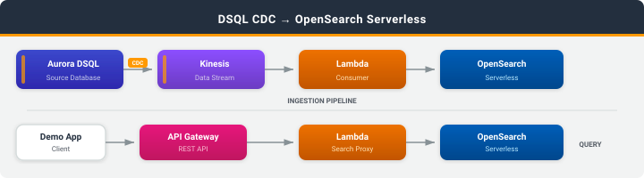

# DSQL CDC to Amazon OpenSearch Serverless

## Introduction

This sample keeps a product catalog in Amazon OpenSearch Serverless in sync with Amazon Aurora DSQL by using change data capture (CDC). DSQL stays the system of record. OpenSearch adds full-text search, autocomplete, and faceted navigation on top of it.

Every INSERT, UPDATE, and DELETE on the DSQL `products` table flows through Amazon Kinesis to an AWS Lambda consumer, which applies it to the OpenSearch index with the `_bulk` API. A second Lambda function serves search queries behind an IAM-authenticated Amazon API Gateway REST API.

### What you'll learn

- How to set up CDC streaming from Amazon Aurora DSQL to Amazon Kinesis
- How to translate DSQL CDC events into OpenSearch index and delete operations
- How to read the DSQL CDC record format (commit timestamps, row images, delete keys)
- How to run OpenSearch Serverless with VPC-only access behind an IAM-authenticated API

## Architecture



```
DSQL --> Kinesis --> Lambda (CDC consumer) --> OpenSearch Serverless
                                                     ^
Client --(SigV4)--> API Gateway --> Lambda (search proxy)
```

1. Products are created, updated, and deleted in DSQL.
2. DSQL streams every row-level change to a Kinesis data stream.
3. The CDC consumer Lambda reads Kinesis records in batches, keeps the `products` table changes, and writes them to OpenSearch with one `_bulk` request per batch.
4. The search proxy Lambda turns API Gateway requests into OpenSearch queries.
5. Clients call the API Gateway endpoints for search, autocomplete, and facets.

Both Lambda functions run in isolated VPC subnets (no NAT gateway or internet gateway) and reach OpenSearch through a VPC endpoint. The collection's network policy denies public access.

## What Gets Deployed

| Resource | Service | Purpose |
|----------|---------|---------|
| VPC, 2 isolated subnets, security group | Amazon VPC | Private network for the Lambda functions |
| VPC endpoints | Amazon VPC, OpenSearch Serverless | Private access to OpenSearch Serverless and AWS STS |
| `dsql-product-search` collection | Amazon OpenSearch Serverless | Search collection with encryption, network, and data access policies |
| Kinesis data stream | Amazon Kinesis | Receives CDC events from DSQL |
| CDC consumer | AWS Lambda | Applies CDC events to the `products` index |
| Search proxy | AWS Lambda | Serves search, autocomplete, facet, and product queries |
| REST API (`prod` stage) | Amazon API Gateway | IAM-authenticated search endpoints |
| Dead-letter queue | Amazon SQS | Metadata for CDC records that failed after retries |
| Log groups | Amazon CloudWatch Logs | Lambda logs (30-day retention) |
| IAM roles | AWS IAM | Least-privilege roles for DSQL and each Lambda function |

Stack name: `DsqlCdcOpenSearchStack`

## Project Structure

```
deploy.sh               # CloudShell: deploy infrastructure and launch the demo
destroy.sh              # CloudShell: remove all deployed resources
demo.py                 # Interactive CLI: generate changes, then search them in OpenSearch
cfn/                    # CloudFormation template
lambda/                 # Lambda source (readable copies of the inline code)
sql/                    # DSQL table DDL
docs/                   # Architecture diagram
```

## Prerequisites

**CloudShell (deploy and demo):**
- Python 3.9+
- pip
- AWS CLI v2.34.61+ (includes the Aurora DSQL CDC stream commands)
- jq 1.6+

**Required IAM permissions:** The deploying principal needs permissions for AWS CloudFormation, Amazon Aurora DSQL, Amazon Kinesis, Amazon OpenSearch Serverless, AWS Lambda, Amazon API Gateway, Amazon EC2 (VPC resources), Amazon SQS, AWS IAM, and Amazon CloudWatch Logs. The demo user needs `execute-api:Invoke` on the deployed API.

**Estimated cost:** OpenSearch Serverless bills for a minimum number of OpenSearch Compute Units (OCUs) for as long as the collection exists, and this dominates the cost of the sample. At the minimum capacity this is more than $10 USD per day; see [Amazon OpenSearch Service pricing](https://aws.amazon.com/opensearch-service/pricing/). The other services cost a few cents for a few hours of demo use. To avoid ongoing charges, follow the [Cleanup](#cleanup) instructions as soon as you are done.

## Quick Start

### Step 1: Deploy (CloudShell)

```bash
git clone https://github.com/aws-samples/sample-dsql-cdc-patterns.git
cd sample-dsql-cdc-patterns/patterns/dsql-to-opensearch
bash deploy.sh
```

The script creates a DSQL cluster, deploys the CloudFormation stack, creates the `products` table, and sets up the CDC stream. Creating the OpenSearch Serverless collection takes about 15-20 minutes. The script writes the resulting configuration to `env.sh` and then starts the interactive demo.

Options:
```bash
bash deploy.sh --cluster-id abc123    # reuse existing cluster
bash deploy.sh --region us-west-2     # non-default region
bash deploy.sh --no-demo              # deploy only
```

### Step 2: Run the demo

The demo starts automatically at the end of `deploy.sh`. To start it again later:

```bash
source env.sh
python3 demo.py
```

The demo menu lets you insert random products, update or delete them, and then search, autocomplete, and browse facets through the API. Changes usually appear in search results within about 10-15 seconds: the consumer picks them up from Kinesis, and OpenSearch Serverless refreshes its indexes roughly every 10 seconds.

### Step 3: Call the API directly

All endpoints use IAM (SigV4) authentication. With `curl` 7.75 or later:

```bash
source env.sh
curl -s "${API_GATEWAY_URL}/search?q=wireless&category=Electronics&price_max=200" \
  --aws-sigv4 "aws:amz:${REGION}:execute-api" \
  --user "${AWS_ACCESS_KEY_ID}:${AWS_SECRET_ACCESS_KEY}" \
  -H "x-amz-security-token: ${AWS_SESSION_TOKEN}" | jq .
```

In CloudShell, export temporary credentials first, for example with `aws configure export-credentials --format env`.

| Method | Path | Description |
|--------|------|-------------|
| GET | `/search?q=&category=&brand=&price_min=&price_max=&in_stock=&from=&size=` | Full-text search with filters and highlighting |
| GET | `/autocomplete?q=&size=` | Prefix suggestions on product names |
| GET | `/facets` | Category, brand, price-range, and stock counts |
| GET | `/stats` | Document count |
| GET | `/products?from=&size=` | Products, newest first |
| GET | `/products/{id}` | One product |
| DELETE | `/index` | Delete and recreate the `products` index |

## CDC Record Format

Amazon Aurora DSQL streams each change as a JSON envelope. See [Understanding CDC records](https://docs.aws.amazon.com/aurora-dsql/latest/userguide/cdc-record-format.html).

- INSERT (`op: "c"`) and UPDATE (`op: "u"`) carry the **full** post-change row in `after`; `before` is `null`. The consumer indexes the whole document, so an UPDATE never clears unchanged fields.
- DELETE (`op: "d"`) sets `after` to `null` and puts **only the primary key** columns in `before`. The consumer deletes the document by `id`.
- Transaction metadata (`txId`, `ts_ms`, `ts_ns`) lives under `source`. The top-level `ts_ms`/`ts_ns` are CDC *processing* times, not commit times. `source.ts_ns` is a total order of DSQL transactions; the consumer stores it on each document as `cdc_commit_ts_ns`.
- `timestamptz` columns such as `created_at` and `updated_at` are integers: microseconds since the Unix epoch, UTC. OpenSearch would read a bare integer in a `date` field as epoch *milliseconds*, so the consumer converts them to ISO-8601 strings. DSQL's `infinity`/`-infinity` sentinels become `null`.
- Oversized rows arrive as `type: "chunked"` records plus `type: "fragment"` continuations, which need stateful reassembly. The consumer reports them as batch item failures. After the retries configured on the event source mapping, Lambda sends their metadata (shard and sequence numbers) to the SQS dead-letter queue.

### Ordering

The CDC stream is created with `--ordering UNORDERED`, so changes to the same row can arrive out of commit order. Within each Kinesis batch, the consumer applies only the latest event per `id` by `source.ts_ns`. Across batches, a late-arriving older event can still overwrite a newer document, or re-create a document that was deleted.

OpenSearch external versioning (`version_type=external`) would reject stale writes, but this sample doesn't use it: OpenSearch Serverless doesn't document support for it, and deletes don't leave a version behind to compare against. If you need strict ordering, compare `cdc_commit_ts_ns` before writing, or periodically reconcile the index against DSQL.

## Security

- Amazon OpenSearch Serverless: VPC-only network policy (no public access), AWS-owned encryption key, and data access policies scoped to the `products` index per Lambda role
- Amazon API Gateway: IAM (SigV4) authentication on every method
- AWS Lambda: runs in isolated subnets with no NAT or internet gateway; security group egress limited to HTTPS inside the VPC
- Amazon Kinesis: KMS encryption at rest
- Amazon SQS: SSE encryption on the dead-letter queue
- AWS IAM: least-privilege roles scoped to the specific stream, collection, and queue
- Amazon Aurora DSQL: SSL connections with IAM auth tokens (15-minute expiry)

## Cleanup

> **Important:** The resources deployed by this sample incur ongoing AWS charges, mainly for OpenSearch Serverless capacity. To avoid unexpected costs, clean up all resources when you are done.

```bash
bash destroy.sh
```

`destroy.sh` reads `CLUSTER_ID` and `STREAM_ID` from `env.sh`. It deletes:
1. **CDC stream** -- deleted through the DSQL API
2. **CloudFormation stack** -- the VPC and endpoints, OpenSearch Serverless collection and policies, Kinesis data stream, Lambda functions, API Gateway, SQS queue, IAM roles, and CloudWatch Logs log groups
3. **DSQL cluster** -- deletion protection is disabled and the cluster is deleted

> **Warning:** Deleting the stack permanently deletes the OpenSearch Serverless collection and its index. DSQL remains the source of truth until you delete the cluster.

To verify cleanup completed successfully:
```bash
aws cloudformation describe-stacks --stack-name DsqlCdcOpenSearchStack --region us-east-1
```

This command should return a `StackNotFoundException` error, confirming the stack has been deleted.
