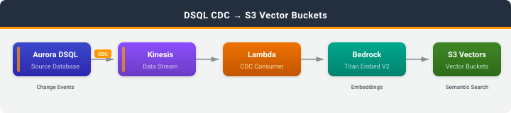

# DSQL CDC to Amazon S3 Vectors

## Introduction

This sample keeps an Amazon S3 Vectors index in sync with a product table in Amazon Aurora DSQL, using change data capture (CDC). Each product is embedded with Amazon Bedrock as it changes, so you can run natural-language similarity search with metadata filters over live DSQL data.

DSQL stays the system of record. Inserts and updates produce a new embedding for the row; deletes remove the row's vector.

### What you'll learn

- How to set up CDC streaming from Amazon Aurora DSQL to Amazon Kinesis
- How to consume DSQL CDC events in AWS Lambda and generate embeddings with Amazon Bedrock (Titan Text Embeddings V2)
- How to store and query vectors with filterable metadata in Amazon S3 Vectors
- How to keep a derived index correct when CDC events arrive out of order

## Architecture



```
DSQL --> Kinesis --> Lambda consumer --(Bedrock embeddings)--> S3 Vectors <-- demo (QueryVectors)
```

1. Aurora DSQL streams CDC events for the `products` table to a Kinesis data stream.
2. A Lambda function consumes the stream in batches.
3. For inserts and updates, the function builds a text description of the product, calls Bedrock Titan Text Embeddings V2 for a 1024-dimension vector, and stores it with `PutVectors`. The product id is the vector key.
4. For deletes, the function removes the vector with `DeleteVectors`.
5. The demo embeds your search query with the same model and calls `QueryVectors`, optionally filtering on category and brand.

## What Gets Deployed

| Resource | Service | Purpose |
|----------|---------|---------|
| Vector bucket `dsql-product-vectors` | Amazon S3 Vectors | Stores product vectors |
| Vector index `products` | Amazon S3 Vectors | 1024 dimensions, cosine distance |
| Kinesis data stream | Amazon Kinesis | Receives CDC events from DSQL (1 shard) |
| CDC consumer | AWS Lambda | Embeds changed rows and writes or deletes vectors |
| Dead-letter queue | Amazon SQS | Records batches that exhaust their retries |
| Log group | Amazon CloudWatch Logs | Consumer logs |
| IAM roles | AWS IAM | Least-privilege roles for DSQL and Lambda |

Stack name: `DsqlCdcS3VectorsStack`

## Project Structure

```
deploy.sh               # CloudShell: deploy infrastructure and launch the demo
destroy.sh              # CloudShell: remove all deployed resources
demo.py                 # Interactive CLI: generate products and run semantic search
cfn/                    # CloudFormation template
lambda/                 # Lambda consumer source (readable copy)
sql/                    # DSQL table DDL
docs/                   # Architecture diagram
```

## Prerequisites

**CloudShell (deploy and demo):**
- Python 3.9+
- pip
- AWS CLI v2.34.61+ (includes the Aurora DSQL CDC stream commands)
- jq 1.6+

**Region:** Deploy to a Region where Amazon Aurora DSQL, Amazon S3 Vectors, and Amazon Bedrock Titan Text Embeddings V2 (`amazon.titan-embed-text-v2:0`) are all available. The default is `us-east-1`. Your account must have access to the Titan model in that Region.

**Required IAM permissions:** The deploying principal needs permissions for AWS CloudFormation, Amazon Aurora DSQL, Amazon Kinesis, AWS Lambda, Amazon S3 Vectors, Amazon SQS, AWS IAM, and Amazon CloudWatch Logs. The demo also needs `bedrock:InvokeModel` and `s3vectors:QueryVectors`, `ListVectors`, `GetVectors`, and `DeleteVectors` on the index.

**Estimated cost:** Running this sample for a few hours with a few hundred products costs less than $1.00 USD. To avoid ongoing charges, follow the [Cleanup](#cleanup) instructions when you are done.

## Quick Start

### Step 1: Deploy (CloudShell)

```bash
git clone https://github.com/aws-samples/sample-dsql-cdc-patterns.git
cd sample-dsql-cdc-patterns/patterns/dsql-to-s3-vectors
bash deploy.sh
```

The script creates a DSQL cluster, deploys the CloudFormation stack, creates the `products` table, and sets up the CDC stream. Deployment takes about 5 minutes. It writes the resulting configuration to `env.sh` and then starts the interactive demo.

Options:
```bash
bash deploy.sh --cluster-id abc123    # reuse existing cluster
bash deploy.sh --region us-west-2     # non-default region
bash deploy.sh --no-demo              # deploy only
```

### Step 2: Run the demo

The demo starts automatically at the end of `deploy.sh`. To start it again later:

```bash
source env.sh
python3 demo.py
```

The demo menu lets you:
- Insert random products, and update or delete existing ones
- Run a semantic search, such as "wireless audio for travel", with optional category and brand filters
- Count the vectors in the index, and list the indexed products with their metadata
- Clear all products and vectors, run a health check, or destroy the stack

New and changed products are searchable a few seconds after you write them to DSQL.

## Vector Metadata

| Key | Filterable | Source |
|-----|-----------|--------|
| `category` | Yes | `category` column |
| `brand` | Yes | `brand` column |
| `price` | Yes | `price` column (a DSQL `numeric`, parsed to a number) |
| `in_stock` | Yes | `in_stock` column |
| `name`, `description`, `tags` | No | Same-named columns |
| `created_at`, `updated_at` | No | `timestamptz` columns, as ISO-8601 UTC strings |
| `cdc_commit_ts_ns` | No | `source.ts_ns` of the change that wrote this vector |

Filterable metadata supports the S3 Vectors query operators (`$eq`, `$ne`, `$gt`, `$gte`, `$lt`, `$lte`, `$in`, `$and`, `$or`). Non-filterable metadata comes back with query results, but you can't filter on it. An index can have at most 10 non-filterable keys.

## CDC Record Format

Amazon Aurora DSQL streams each change as a JSON envelope. See [Understanding CDC records](https://docs.aws.amazon.com/aurora-dsql/latest/userguide/cdc-record-format.html).

- INSERT (`op: "c"`) and UPDATE (`op: "u"`) carry the **full** post-change row in `after`; `before` is `null`.
- DELETE (`op: "d"`) sets `after` to `null` and puts **only the primary key** columns in `before`. The consumer deletes the vector by that key. It doesn't embed anything for deletes.
- Transaction metadata (`txId`, `ts_ms`, `ts_ns`) lives under `source`. The top-level `ts_ms`/`ts_ns` are CDC *processing* times, not commit times.
- `timestamptz` columns are integers: microseconds since the Unix epoch, UTC. `numeric` columns such as `price` are JSON strings.
- Oversized rows (over 9 MiB) arrive as `type: "chunked"` records plus `type: "fragment"` continuations. The consumer can't reassemble them, so it logs and skips them.

## Ordering and Retries

The CDC stream uses `UNORDERED` delivery, so an older change can arrive after a newer one. `source.ts_ns` gives a total order of DSQL transactions, and the consumer uses it in two ways:

- **Within a batch**, it keeps only the newest event for each product id.
- **Across batches**, it stores `cdc_commit_ts_ns` on every vector. It reads the stored value with `GetVectors` first and skips any write or delete older than the stored one. Stale updates are skipped before they reach Bedrock, so they cost nothing to embed.

This read-compare-write is safe because the stream has one shard and the event source mapping uses `ParallelizationFactor: 1`, so only one invocation runs at a time. If you add shards or raise the parallelization factor, concurrent invocations can race. DSQL uses random partition keys, so changes to the same row can be in different shards.

**Caveat:** A delete removes the vector and leaves nothing to compare against. If an UPDATE is delivered after its row's DELETE has already been applied in an earlier batch, the vector comes back. To rule this out, store tombstones instead of deleting, or periodically reconcile the index against DSQL.

Records the consumer fails to process (for example, Bedrock throttling) are reported as batch item failures and retried up to 3 times. After that, Lambda sends a record of the failed batch to the SQS dead-letter queue.

## Security

- Amazon S3 Vectors: encrypted at rest with SSE-S3 (the vector bucket default)
- Amazon Kinesis: KMS encryption at rest
- Amazon SQS: SSE-SQS encryption at rest
- AWS IAM: least-privilege roles scoped to the specific stream, vector index, Bedrock model, and queue
- Amazon Aurora DSQL: SSL connections with IAM auth tokens (15-minute expiry)
- No public endpoints or AWS Lambda function URLs

## Cleanup

> **Important:** The resources deployed by this sample incur ongoing AWS charges. To avoid unexpected costs, clean up all resources when you are done.

```bash
bash destroy.sh
```

`destroy.sh` reads `CLUSTER_ID` and `STREAM_ID` from `env.sh`. It deletes:
1. **CDC stream** -- deleted through the DSQL API
2. **CloudFormation stack** -- the vector index (and all vectors), vector bucket, Kinesis data stream, Lambda function, SQS queue, IAM roles, and CloudWatch Logs log group
3. **DSQL cluster** -- deletion protection is disabled and the cluster is deleted

Nothing is retained. The vectors are derived from DSQL data, so the stack deletes the vector index and bucket.

To verify cleanup completed successfully:
```bash
aws cloudformation describe-stacks --stack-name DsqlCdcS3VectorsStack --region us-east-1
```

This command should return a `StackNotFoundException` error, confirming the stack has been deleted.
